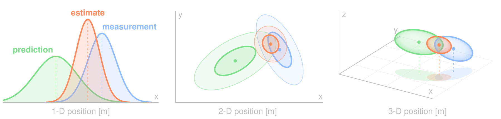
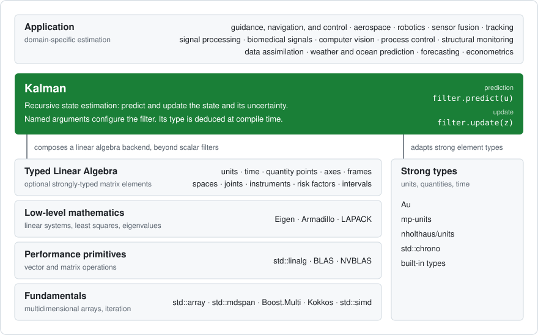

<style>
.reveal pre { width: 100%; font-size: 0.5em; }
.reveal pre code { max-height: none; }
.reveal .columns { display: flex; gap: 16px; }
.reveal .columns > div { flex: 1; min-width: 0; }
.reveal .columns pre { font-size: 0.45em; }
</style>

<section data-background-image="welcome.png" data-background-size="contain">
<aside class="notes">
Welcome to Typed Kalman Filter. Hello, my name is François Carouge. Tonight we are going to talk about safety and developer ergonomics. We will use the C++ strong type system to make Kalman filtering easier and safer. Thank you for coming tonight and having me here at this ROS By-The-Bay meetup.
</aside>
</section>

---


<aside class="notes">
<b>Do you know which launch this is?</b><br />
The December 1998 launch of the Mars Climate Orbiter for 327 million dollars. The program reached Mars at about 57 km of altitude instead of the planned 226 km and crashed. A ground program produced impulse in pound-force seconds, the navigation software read it as newton seconds. A factor of 4.45 that no test ever saw, because both sides were just numbers.<br />
This is not a memory safety bug. This is a specification, integration, or implemenation defect. Unit tests don't catch this. Although it would be nice to catch this class of defect before our robots arrive on another planet. Let's catch these defects at compile-time!
</aside>

---

###### Kalman Filtering



<small>

**Predict**: Move the estimate, uncertainty grows.<br />
<br />
**Update**: Correct by measurement, uncertainty shrinks.

</small>

<span class="fragment">

**Linear algebra over mixed physical quantities**.<br />

<small>

x = [3 m, 2 m/s, 1 m/s²]

</small>


</span>

<aside class="notes">
The Kalman filter is a Bayesian filter that uses multivariate Gaussians. It is a control theory tool applicable to signal estimation, sensor fusion, or data assimilation problems.<br />
A filter has two operations: predict and update. The filter predicts estimates by adding Gaussians: the uncertainty grows. The filter can be corrected, updated with measurements by multiplying Gaussians: the uncertainty shrinks.<br />
Your robots run Kalman filters: 
TODO: LIST OUT, VERIFY ROS2 FILTERS.
In your stack: `robot_localization` (EKF, UKF), IMU and odometry fusion, Autoware's `ekf_localizer` and `multi_object_tracker`.<br />
FRAGMENT<br />
The filter uses linear algebra operations over states and covariances but beware, the elements of the filter state may not be of the same type, kind, or quantity as seen in the 1-Dimensional position, velocity, acceleration state.
</aside>

---

###### The Problem

```cpp
// Position [m], velocity [m/s], acceleration [m/s²]
Vector3d x{10., 5., 2.};
```

<span class="fragment">

```cpp
double nonsense{x(0) + x(1)}; // m + m/s ? compiles to 15.
```

</span>

<span class="fragment">

| Safety Gap |
| --- |
| Units |
| Kinds |
| Frames |

</span>

<aside class="notes">
In an untyped vector or matrix, a position, a velocity or an angle are all just floating-point values.<br />
FRAGMENT<br />
Adding a position to a velocity compiles and computes. However the operation and its result are nonsensical.<br />
FRAGMENT<br />
Maybe your linear algebra backend guarantees at compile-time the dimension of the vector or matrices.
What about adding a velocity to a position?
What about adding a height to a width? Or length in x or y? Or timepoints?
What about in different reference frames?
</aside>

---

###### The Idea

```cpp
using state =
    column_vector<double, position, velocity, acceleration>;

const state x{3. * m, 2. * m / s, 1. * m / s2};

std::println("{}", x * transposed(x));
```

<span class="fragment">

```text
[[9 m²,    6 m²/s,  3 m²/s²],
 [6 m²/s,  4 m²/s², 2 m²/s³],
 [3 m²/s², 2 m²/s³, 1 m²/s⁴]]
```

</span>

<span class="fragment">

Element type = row type × column type.<br />
<small>Useful physical matrices factorize, so N + M types describe N × M elements.</small>

</span>

<aside class="notes">
5:15. Typed Linear Algebra. A facade over an established backend such as Eigen, it is not another matrix library.<br />
FRAGMENT<br />
A vector times its transpose is what a covariance is made of, and the units compose by themselves.<br />
FRAGMENT<br />
Hart and Hall's result, covered in depth in the C++Now talk: the unit of an element is the product of its row and column unit. Matrix products collapse the inner indexes and keep the outer ones. That is why this is tractable.
</aside>

---

###### Before and After

<div class="columns">
<div>

<small>Eigen</small>

```cpp
Eigen::Vector2d x{10., 2.};

Eigen::Matrix2d f{{1., 0.02},
                  {0., 1.}};

Eigen::Matrix2d p{{4., 0.},
                  {0., 4.}};


const Eigen::Vector2d predicted{
    f * x};
const Eigen::Matrix2d uncertainty{
    f * p * f.transpose()};
```

</div>
<div>

<small>Typed, on the same Eigen</small>

```cpp
const track x{10. * m, 2. * m / s};

track_transition f{
  track_transition::matrix::Identity()};
f.at<0, 1>(0.02 * s);

track_covariance p;
p.at<0, 0>(4. * m2);
p.at<1, 1>(4. * m2 / s2);

const track predicted{f * x};
const track_covariance uncertainty{
    f * p * transposed(f)};
```

</div>
</div>

<span class="fragment">

The equations do not change. `uncertainty.at<0, 1>()` is `0.08 m²/s`.

</span>

<aside class="notes">
6:15. Same computation, same Eigen underneath. Declaring is more verbose on the right and I will come back to that cost.<br />
FRAGMENT<br />
The equations read the same, and now each element knows what it is.
</aside>

---

###### Live: Introduce a Bug

```cpp
kalman filter{state{track{0. * m, 0. * m / s}}, /* ... */};

const velocity speed{filter.x().at<0>()}; // Swapped index.
```

```text
error: no matching constructor for initialization of 'const velocity'
```

<span class="fragment">

```cpp
const auto sum{filter.x().at<0>() + filter.x().at<1>()};
```

```text
error: invalid operands to binary expression
       ('quantity<reference<isq::length, si::metre>{}>' and
        'quantity<reference<isq::velocity, ...>{}>')
```

</span>

<span class="fragment">

```cpp
const impulse thrust{10. * lbf * s}; // 44.4822 N·s: no bug.
```

</span>

<aside class="notes">
7:00. LIVE DEMO, fallback video ready. Swap two state indexes in the editor and compile. Then add meters to meters per second.<br />
FRAGMENT<br />
Second bug, same outcome. The messages are trimmed here, I will be honest about their full length later.<br />
FRAGMENT<br />
And the actual Mars mistake? Better than the joke on the title slide: mixing the units is not an error at all. The conversion is correct by construction. What stays rejected is a bare double, or a force where an impulse is expected.
</aside>

---

###### The Kalman Project

```cpp
kalman filter{
    state{track{position{10. * m}, velocity{0. * m / s}}},
    output<sighting>,
    input<acceleration>,
    estimate_uncertainty{/* [m², m²/s²] */},
    process_uncertainty{/* ... */},
    output_uncertainty{pow<2>(measurement_deviation)},
    output_model{/* ... */},
    state_transition{/* ... */},
    input_control{/* ... */}};

filter.predict(vehicle_acceleration);
filter.update(camera_position);
```

<small>

Named arguments, deduced filter type. Excerpt of `kf_2x1x1_delayed_target_tracking_unit`: a target tracked from delayed camera measurements, inspired by the vision target estimator of PX4.

</small>

<aside class="notes">
8:00. A real sample from the repository, not a toy. You name the characteristics, class template argument deduction selects the filter. Two lines to run it. The sample rewinds the filter to the instant a delayed camera image describes, then replays the predictions. The history is typed too, so a rewind can only restore the filter's own types.
</aside>

---

###### Design Goals

<small>**Generic** · **Header-only** · **Safe by construction** · **No lock-in**</small>



<aside class="notes">
9:45. Four goals. Generic: the default filter is one double, the samples go up to a 9-state gimbal attitude filter inspired by ArduPilot. Header-only and public domain. Safe by construction: units, order and sizes. No lock-in: no framework, no allocation, freestanding compatible. The filter is a layer between your application and the linear algebra backend you already use. No framework is involved, which matters for the rest of this talk.
</aside>

---

###### Your Odometry Today

`nav_msgs/Odometry`: `pose.covariance` is a row-major `float64[36]`

<table style="font-size:0.62em; text-align:center;">
<tr><th></th><th>x</th><th>y</th><th>z</th><th>roll</th><th>pitch</th><th>yaw</th></tr>
<tr><th>x</th><td style="color:#7ddf8a">m² <small>[0]</small></td><td style="color:#7ddf8a">m²</td><td style="color:#7ddf8a">m²</td><td style="color:#ff8a5c">m·rad</td><td style="color:#ff8a5c">m·rad</td><td style="color:#ff8a5c">m·rad <small>[5]</small></td></tr>
<tr><th>y</th><td style="color:#7ddf8a">m²</td><td style="color:#7ddf8a">m² <small>[7]</small></td><td style="color:#7ddf8a">m²</td><td style="color:#ff8a5c">m·rad</td><td style="color:#ff8a5c">m·rad</td><td style="color:#ff8a5c">m·rad</td></tr>
<tr><th>z</th><td style="color:#7ddf8a">m²</td><td style="color:#7ddf8a">m²</td><td style="color:#7ddf8a">m²</td><td style="color:#ff8a5c">m·rad</td><td style="color:#ff8a5c">m·rad</td><td style="color:#ff8a5c">m·rad</td></tr>
<tr><th>roll</th><td style="color:#ff8a5c">m·rad</td><td style="color:#ff8a5c">m·rad</td><td style="color:#ff8a5c">m·rad</td><td style="color:#8fbcff">rad²</td><td style="color:#8fbcff">rad²</td><td style="color:#8fbcff">rad²</td></tr>
<tr><th>pitch</th><td style="color:#ff8a5c">m·rad</td><td style="color:#ff8a5c">m·rad</td><td style="color:#ff8a5c">m·rad</td><td style="color:#8fbcff">rad²</td><td style="color:#8fbcff">rad²</td><td style="color:#8fbcff">rad²</td></tr>
<tr><th>yaw</th><td style="color:#ff8a5c">m·rad</td><td style="color:#ff8a5c">m·rad</td><td style="color:#ff8a5c">m·rad</td><td style="color:#8fbcff">rad²</td><td style="color:#8fbcff">rad²</td><td style="color:#8fbcff">rad² <small>[35]</small></td></tr>
</table>

<span class="fragment">

**Who here has indexed this wrong?**

</span>

<aside class="notes">
11:00. The centrepiece. Three units in one array of 36 doubles, no types at all, and the twist covariance next to it has the same type with different units: m²/s², m·rad/s², rad²/s².<br />
FRAGMENT<br />
Ask, then wait. Hands will go up.
</aside>

---

###### Convert Once, at the Node Boundary

```cpp
using pose = column_vector<double, distance, distance, distance,
                           angle, angle, angle>;
using pose_covariance =
    matrix<double, pose::row_indexes, pose::row_indexes>;

auto to_covariance(const std::array<double, 36> &covariance) {
  using row_major = Eigen::Matrix<double, 6, 6, Eigen::RowMajor>;
  return pose_covariance{
      Eigen::Map<const row_major>{covariance.data()}};
}
```

<span class="fragment">

```cpp
covariance.at<0, 5>(); // quantity<m·rad>
covariance.at<0, 6>(); // Rejected at compile time: out of bounds.
```

</span>

<span class="fragment">

```cpp
// REP-103, SI units, and REP-105, frames, become types:
inline constexpr struct odom_x final
    : quantity_spec<isq::length, is_kind> {} odom_x;

1. * odom_x[m] + 1. * base_link_x[m]; // Rejected.
```

</span>

<aside class="notes">
11:45. The opportunity. Everything inside the node is checked at compile time and the conversion lives in one function. There is one sharp edge, the conversion itself is where you still have to be right: it is the one place to review and to test.<br />
FRAGMENT<br />
The compiler knows the element is in meter radians and knows there is no column 6.<br />
FRAGMENT<br />
REP-103 and REP-105 stop being documentation. A frame can be a distinct kind of quantity, and it works through the whole filter. Remember the Odometry message itself: the pose is in header.frame_id and the twist in child_frame_id.
</aside>

---

###### The Demo: IMU and Odometry Fusion

```cpp
auto to_position(const nav_msgs::msg::Odometry &msg) {
  return position{msg.pose.pose.position.x * m};
}

auto to_velocity(const nav_msgs::msg::Odometry &msg) {
  return velocity{msg.twist.twist.linear.x * m / s};
}

auto to_acceleration(const sensor_msgs::msg::Imu &msg) {
  return acceleration{msg.linear_acceleration.x * m / s2};
}
```

```cpp
void on_imu(const sensor_msgs::msg::Imu &msg) {
  filter.predict(to_acceleration(msg));
}

void on_odometry(const nav_msgs::msg::Odometry &msg) {
  filter.update(to_position(msg));
}
```

<aside class="notes">
12:30. LIVE DEMO, fallback video ready. A small node, one axis for the slide: three conversions at the boundary, two callbacks. The IMU drives the prediction, the odometry corrects it. A complete node would also remove gravity and rotate the acceleration into the odometry frame.
</aside>

---

###### The Bug

```cpp
filter.update(msg.twist.twist.linear.x); // A velocity!
```

<div class="columns">
<div>

**Untyped filter**

Compiles. Runs. No warning.

After 10 s at 1 m/s:<br />
`1 m`, the truth is `10 m`.

</div>
<div>

**Typed filter**

```cpp
filter.update(to_velocity(msg));
```

```text
error: no matching member
function for call to 'update'
```

</div>
</div>

<aside class="notes">
13:15. One wrong field. On the left, the untyped filter accepts it and converges happily on the wrong answer: a simulated run gives 1 meter after 10 seconds where the robot has travelled 10. Nothing tells you: the covariance is exactly that of a healthy run, since it does not depend on the measured values.<br />
On the right, the typed filter refuses to compile. A bare double is rejected as well, so the raw message field does not even get this far.
</aside>

---

###### The Value

- **Whole bug classes removed** at compile time: units, state order, bounds, tagged frames
- **Zero run-time cost**, as measured in a moment
- **Less test burden**: stop testing what cannot compile
- **A stronger safety argument** for ISO 26262 and IEC 61508 type work

<span class="fragment">

<small>

Not caught: a wrong model, bad tuning, two axes of the same untagged type, a wrong conversion at the boundary.

</small>

</span>

<aside class="notes">
13:50. The whole proposition on one slide. On safety: this is evidence that a class of faults is excluded by construction, it is not a certification of the library.<br />
FRAGMENT<br />
Say it before somebody asks: x and y are both positions, so swapping them compiles unless you tag them. Types do not design your filter.
</aside>

---

###### Beyond ROS 2

The core depends on no framework. Adapters stay thin.

<small>

| Ecosystem | What changes |
| --- | --- |
| ROS 1, Autoware, Isaac ROS | The same message adapter |
| PX4, uORB | An adapter per topic: terrain and wind samples follow its estimators |
| micro-ROS, embedded | The freestanding backend |
| Drake, in-house stacks | Eigen is already there, wrap the state type |

</small>

**Write the estimator once, typed. Deploy it anywhere C++ runs.**

<aside class="notes">
14:30. First section to cut if time is short. Only the boundary is specific to an ecosystem. The repository has samples following estimators of PX4 and ArduPilot. The core header is freestanding: no hosted-only header, no exception, no run-time type information, no allocation.
</aside>

---

###### Performance: Identical Assembly

<div class="columns">
<div>

<small>`Eigen`: `f * x`</small>

```x86asm
movapd   (%rdx), %xmm0
movapd   %xmm0, %xmm1
unpcklpd %xmm0, %xmm1
mulpd    (%rsi), %xmm1
unpckhpd %xmm0, %xmm0
mulpd    16(%rsi), %xmm0
addpd    %xmm1, %xmm0
movapd   %xmm0, (%rdi)
retq
```

</div>
<div>

<small>`typed_matrix` + `mp-units`: `f * x`</small>

```x86asm
movapd   (%rdx), %xmm0
movapd   %xmm0, %xmm1
unpcklpd %xmm0, %xmm1
mulpd    (%rsi), %xmm1
unpckhpd %xmm0, %xmm0
mulpd    16(%rsi), %xmm0
addpd    %xmm1, %xmm0
movapd   %xmm0, (%rdi)
retq
```

</div>
</div>

<small>

Clang 21 and GCC 15, `-O2`: also identical for `f * p * transposed(f) + q`.<br />
Whole filter: inlining differs, the results are **bit-identical**.

</small>

<aside class="notes">
16:00. The most convincing slide for this crowd. Two different source files, one with position and velocity types. Line for line the same instructions, and it is the same for the covariance prediction, on both compilers.<br />
Be precise: a whole filter step is not identical assembly, the inliner decides differently. Its numerical results are identical to the last bit: I compared the first state element after 10⁶ steps, with <code>-ffp-contract=off</code>.
</aside>

---

###### Performance: Same Timings

<small>

| One predict and update, ns | Untyped Eigen | Typed + mp-units |
| --- | ---: | ---: |
| 6x2x0, Clang 21 | 193 | 197 |
| 6x2x0, GCC 15 | 154 | 156 |
| 2x1x0, Clang 21 | 63 | 29 |
| 2x1x0, GCC 15 | 22 | 16 |

Best batch of 10⁶ steps over 6 runs of 15 batches, x86-64, `-O2`. The 6x2x0 gap is within the run-to-run noise. The 2x1x0 gain is not from typing: the typed 1x1 division is scalar, the untyped one a QR solve.

**Fixed sizes**: rows and columns are type lists, so sizes are compile-time facts, with no allocation.<br />
**Backends**: built-in types, Eigen, Eigen + TLA, Eigen + TLA + mp-units, freestanding.<br />
**Cortex-M4**, freestanding, untyped `float`: `kf_2x1x1` 784 B flash, 100 B RAM; `ekf_9x4x0` 10 kB, 1.5 kB.

</small>

<aside class="notes">
17:00. Same timings where it is the same algorithm. Do not claim typing makes the filter twice as fast: it is the 1x1 division that differs, which is a backend choice.<br />
Measured with <code>-O2 -DNDEBUG -fno-exceptions -ffp-contract=off</code> on my development machine, under WSL2. Fixed sizes only: there is no dynamic size backend exercised in the repository. The embedded numbers are one Joseph form step at O2, from the footprint page, which CI fails on any change.
</aside>

---

###### The Honest Cost

<small>

| | Untyped | Typed |
| --- | ---: | ---: |
| Compile a 6x2x0 filter, Clang 21 | 5.5 s | 18.6 s |
| Compile a 6x2x0 filter, GCC 15 | 6.6 s | 18.2 s |
| Clang error, wrong type to `update` | | 13 lines |
| Clang error, wrong element type | | 118 to 217 lines |

Declarations are longer too: `at<0, 1>(0.02 * s)` instead of a matrix literal.

What helps: constrained `update` and `predict`, type aliases in the messages, one translation unit per filter behind a plain interface.

</small>

<aside class="notes">
17:45. Compile time is about three times longer in this translation unit, and the first error line is usually the useful one but the rest of the message can be long. Constraints keep a misuse of the filter itself short. Errors from the mp-units operators are the long ones.
</aside>

---

###### Try It in One Node

<small>

Wrap one estimator. Keep the rest of the stack as-is.<br />
**Tell me your use case**: feedback, issues, real filters to support.

</small>

<div style="display:flex; gap:32px; justify-content:center;">
<div><br /><small>Kalman</small></div>
<div><br /><small>Typed Linear Algebra</small></div>
<div><br /><small>C++Now 2026 talk</small></div>
</div>

**Let the compiler land the robot.**

<aside class="notes">
18:30. Low commitment: one node, one estimator, nothing else changes. And I want to hear about your filters, that is what shapes the library. Both repositories and the longer C++Now talk are behind these codes. Thank you. Let the compiler land the robot.
</aside>

---

###### Backup: How Does This Work With Eigen and Existing Code?

```cpp
// From Eigen, at the boundary: explicit, unchecked by design.
const track_covariance p{
    Eigen::Matrix2d{{4., 0.}, {0., 4.}}};

// To Eigen, for a solver or an existing function:
const Eigen::Matrix2d &storage{p.data()};
```

<small>

`typed_matrix` composes the Eigen matrix, it does not replace it: same storage, same kernels, same solvers. The migration can stop at any node boundary.

</small>

<aside class="notes">
Q&A bait. You will almost certainly get this question. The typed matrix is a facade: it stores the backend matrix. Conversion in is explicit because it is where the types are asserted, not checked.
</aside>
