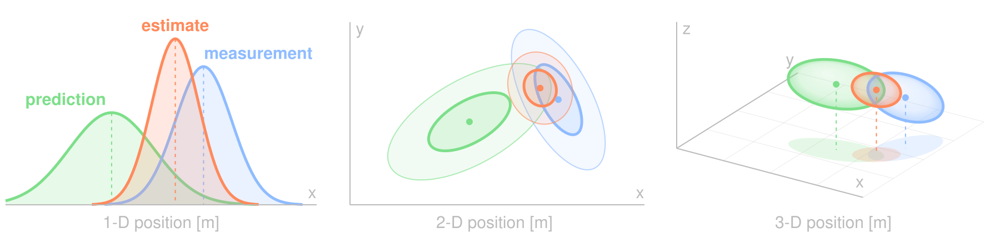
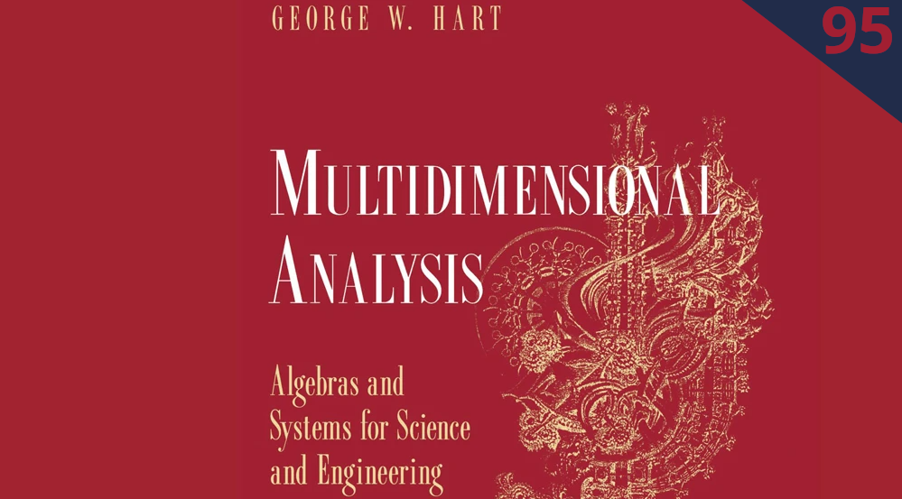
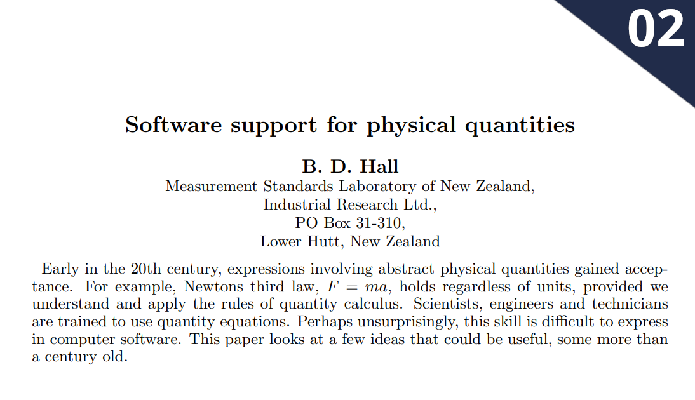
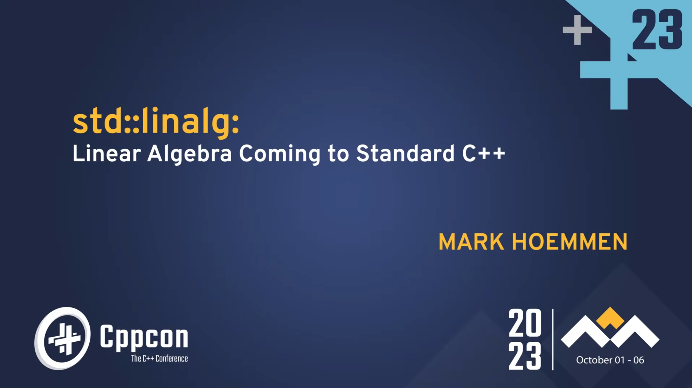
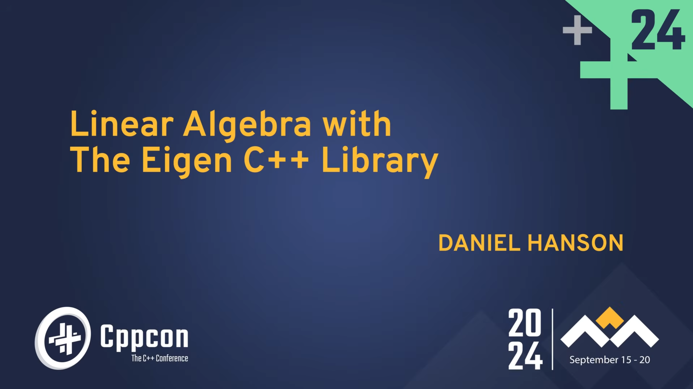
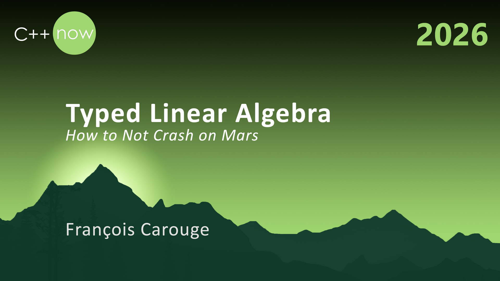
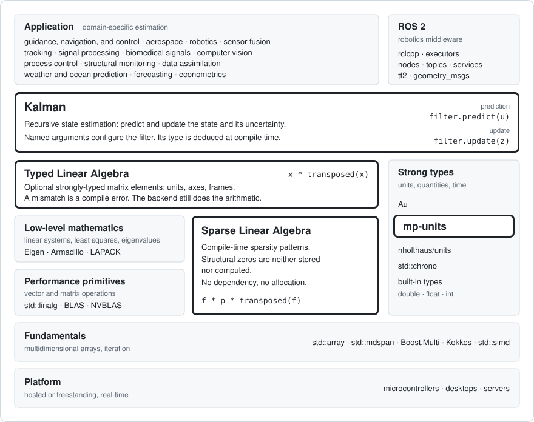

<style>
.reveal pre { width: 100%; font-size: 0.5em; }
.reveal pre code { max-height: none; }
.reveal .columns { display: flex; gap: 16px; }
.reveal .columns > div { flex: 1; min-width: 0; }
.reveal .columns pre { font-size: 0.45em; }
</style>

<section data-background-image="welcome.png" data-background-size="contain">
<aside class="notes">
Welcome to Typed Kalman Filter. Hello, my name is François Carouge. Tonight we are going to talk about safety and developer ergonomics. We will use the C++ strong type system to make Kalman filtering easier and safer. Thank you for coming tonight and having me here at this ROS By-The-Bay meetup.
</aside>
</section>

---


<aside class="notes">
<b>Do you know which launch this is?</b><br />
The December 1998 launch of the Mars Climate Orbiter for 327 million dollars. The program reached Mars at about 57 km of altitude instead of the planned 226 km and crashed. A ground program produced impulse in pound-force seconds, the navigation software read it as newton seconds. A factor of 4.45 that no test ever saw, because both sides were just numbers.<br />
This is not a memory safety bug. This is a specification, integration, or implemenation defect. Unit tests don't catch this. Although it would be nice to catch this class of defect before our robots arrive on another planet. Let's catch these defects at compile-time!
</aside>

---

###### Kalman Filtering



<small>

**Predict**: Move the estimate, uncertainty grows.<br />
<br />
**Update**: Correct by measurement, uncertainty shrinks.

</small>

<span class="fragment">

**Linear algebra over mixed physical quantities**.<br />

<small>

State: x = [3 m, 2 m/s, 1 m/s²]

</small>


</span>

<aside class="notes">
The Kalman filter is a Bayesian filter that uses multivariate Gaussians. It is a control theory tool applicable to signal estimation, sensor fusion, or data assimilation problems.<br />
A filter has two operations: predict and update. The filter predicts estimates by adding Gaussians: the uncertainty grows. The filter can be corrected, updated with measurements by multiplying Gaussians: the uncertainty shrinks.<br />
Your robots run Kalman filters: 
TODO: LIST OUT, VERIFY ROS2 FILTERS.
In your stack: `robot_localization` (EKF, UKF), IMU and odometry fusion, Autoware's `ekf_localizer` and `multi_object_tracker`.<br />
FRAGMENT<br />
The filter uses linear algebra operations over states and covariances but beware, the elements of the filter state may not be of the same type, kind, or quantity as seen in the 1-Dimensional position, velocity, acceleration state.
</aside>

---

###### The Problem

```cpp
// State:
Vector3d x{ 3.,  // Position     [m]
            2.,  // Velocity     [m/s]
            1.}; // Acceleration [m/s²]
```

```cpp
double nonsense{x(0) + x(1)}; // m + m/s ? Compiles to 15 ❌
```

<small>

<span class="fragment">

| Safety Gap |
| --- |
| Units |
| Kinds |
| Frames |
| ... |

</span>

</small>

<aside class="notes">
In an untyped vector or matrix, a position, a velocity or an angle are all just floating-point values. Adding a position to a velocity compiles and computes. However the operation and its result are nonsensical.<br />
FRAGMENT<br />
Maybe your linear algebra backend guarantees at compile-time the dimension of the vector or matrices.
What about adding a velocity to a position?
What about adding a height to a width? Or length in x or y? Or timepoints?
What about in different reference frames?
What about other invarrieant properties of your domain? 
</aside>

---

###### Objective

<small>

6-DoF Pose Covariance Odometry

<table style="font-size:0.62em; text-align:center;">
<tr><th></th><th>x</th><th>y</th><th>z</th><th>roll</th><th>pitch</th><th>yaw</th></tr>
<tr><th>x</th><td style="color:#7ddf8a">m²</td><td style="color:#7ddf8a">m²</td><td style="color:#7ddf8a">m²</td><td style="color:#ff8a5c">m·rad</td><td style="color:#ff8a5c">m·rad</td><td style="color:#ff8a5c">m·rad</td></tr>
<tr><th>y</th><td style="color:#7ddf8a">m²</td><td style="color:#7ddf8a">m²</td><td style="color:#7ddf8a">m²</td><td style="color:#ff8a5c">m·rad</td><td style="color:#ff8a5c">m·rad</td><td style="color:#ff8a5c">m·rad</td></tr>
<tr><th>z</th><td style="color:#7ddf8a">m²</td><td style="color:#7ddf8a">m²</td><td style="color:#7ddf8a">m²</td><td style="color:#ff8a5c">m·rad</td><td style="color:#ff8a5c">m·rad</td><td style="color:#ff8a5c">m·rad</td></tr>
<tr><th>roll</th><td style="color:#ff8a5c">m·rad</td><td style="color:#ff8a5c">m·rad</td><td style="color:#ff8a5c">m·rad</td><td style="color:#8fbcff">rad²</td><td style="color:#8fbcff">rad²</td><td style="color:#8fbcff">rad²</td></tr>
<tr><th>pitch</th><td style="color:#ff8a5c">m·rad</td><td style="color:#ff8a5c">m·rad</td><td style="color:#ff8a5c">m·rad</td><td style="color:#8fbcff">rad²</td><td style="color:#8fbcff">rad²</td><td style="color:#8fbcff">rad²</td></tr>
<tr><th>yaw</th><td style="color:#ff8a5c">m·rad</td><td style="color:#ff8a5c">m·rad</td><td style="color:#ff8a5c">m·rad</td><td style="color:#8fbcff">rad²</td><td style="color:#8fbcff">rad²</td><td style="color:#8fbcff">rad²</td></tr>
</table>

</small>

<span class="fragment">

```cpp
// Update the estimate uncertainty P of a Kalman filter:
p = (i - k * h) * p * t(i - k * h) + k * r * t(k);

std::println("{}", p);
//[[ 0.25 m²,     0.04 m²,     0.01 m²,     0.02 m·rad, -0.01 m·rad,  0.03 m·rad],
// [ 0.04 m²,     0.20 m²,     0.02 m²,     0.01 m·rad,  0.02 m·rad, -0.04 m·rad],
// [ 0.01 m²,     0.02 m²,     0.09 m²,    -0.01 m·rad,  0.01 m·rad,  0.01 m·rad],
// [ 0.02 m·rad,  0.01 m·rad, -0.01 m·rad,  0.04 rad²,   0.01 rad²,   0.01 rad²],
// [-0.01 m·rad,  0.02 m·rad,  0.01 m·rad,  0.01 rad²,   0.03 rad²,   0.02 rad²],
// [ 0.03 m·rad, -0.04 m·rad,  0.01 m·rad,  0.01 rad²,   0.02 rad²,   0.06 rad²]]
```

</span>

<aside class="notes">
We can illustrate the problem with the pose covariance. It is too easy to query the wrong indexes and get a floating-point value without type semantic.<br />
FRGMENT<br />
</aside>

---









<aside class="notes">
Our problem is not new and solutions do exist. We may not always dedimensionalize linear algebra systems for implementation or practical reasons. And we always want safer, strongly typed interface. These references inform us of existing solutions. Today we will typed linear algebra to Kalman filtering.
</aside>

---

###### mp-units

<div class="columns">
<div style="flex:0 0 20%;">
<br />
<small>mpusz.github.io/<br />mp-units</small>
<br />
</div>
<div>

```cpp
quantity         distance{1500. * m};
quantity         duration{2. * min};
quantity         speed   {distance / duration}; // 750 m/min
quantity<km / h> report  {speed};               // 45 km/h

quantity<N * s>  impulse {1. * lbf * s};        // 4.45 N s
```

<span class="fragment">

```cpp
quantity         nonsense{distance + duration}; // ❌ Compilation.
quantity<m>      wrong   {duration};            // ❌ Compilation.
```

<small>

- Compile-time guarantee: dimension, unit, and kind.
- Conversions: automatic, exact, explicit.
- Zero runtime overhead.
- Open-source, ease of integration, established.

</small>

</span>

</div>
</div>

<aside class="notes">
Before we go further, a quick introduction to the strong types we will use tonight. A strong type carries its meaning in the type itself rather than in the variable name or a comment: a quantity knows it is a length in metres, not just a double. mp-units is Mateusz Pusz's C++ physical quantities and units library, and the code is behind this QR code.<br />
Read the code from the top: a distance in metres, a duration in minutes. Dividing them gives a speed, and the library works out the unit: metres per minute. Ask for kilometres per hour and it converts for you: 45. The last line is our Mars Climate Orbiter: one pound-force second becomes 4.45 newton seconds, converted correctly instead of read as the wrong number.<br />
FRAGMENT<br />
And the nonsense from earlier no longer compiles. Adding a distance to a duration is rejected. Storing a duration in a variable that holds metres is rejected. The compiler catches the defect before a test or a robot ever runs it.<br />
FRAGMENT<br />
In short: dimension, unit, and kind errors are caught at compile time. Conversions are done for you, with exact scaling factors. And it costs nothing at run time: the quantity is a plain double in the generated code. It is header-only, open source, and proposed for the C++ standard. One scalar is easy, though. Our filter state is a vector of different quantities, and that is the next step.
</aside>

---

###### Typed Linear Algebra

```cpp
using state = column_vector<double, position, velocity, acceleration>;
```
<span class="fragment">

```cpp
state x{3. * m, 2. * m / s, 1. * m / s2};
```

</span>

<span class="fragment">

```cpp
std::println("{}", x * transposed(x));

// [[9 m²,    6 m²/s,  3 m²/s²],
//  [6 m²/s,  4 m²/s², 2 m²/s³],
//  [3 m²/s², 2 m²/s³, 1 m²/s⁴]]
```

</span>

<span class="fragment">

<small>

The **matrix element type** is the resulting type from that **row type by that column type**.<br />

</small>

```cpp
typed_matrix<Matrix, RowIndexes, ColumnIndexes>
```

</span>

<aside class="notes">
The typed linear algebra is only facade over your chosen linear algebra library. Linear algebra operations are delegated, not implemented.<br />
FRAGMENT<br />
A vector times its transpose is essentially a covariance. The units compose by themselves.<br />
FRAGMENT<br />
The unit of an element is the product of its row and column unit. Matrix products collapse the inner indexes and keep the outer ones. The type compilation is tractable.
</aside>

---

###### Kalman

```cpp
kalman filter{
              state                { /* ... */ },
              output               < /* ... */ >,
              input                < /* ... */ >,
              estimate_uncertainty { /* ... */ },
              process_uncertainty  { /* ... */ },
              output_uncertainty   { /* ... */ },
              output_model         { /* ... */ },
              state_transition     { /* ... */ },
              input_control        { /* ... */ }};

filter.predict( /* ... */ );
filter.update ( /* ... */ );

std::println("{}", filter.x<acceleration>()); // 1 m/s²
```

<small>

Declarative. Named arguments. Safe by construction.<br />
Deduced filter type. Generic. Configurable. Bare-metal.

</small>

<aside class="notes">
The typed linear algebra is then used as part of the Kalman filter declaration. The filter type uses a declarative pattern. You declare the states to be estiimated. The measurement output used. And if there is any control in the model. You declare the various noises and any necessary models. All the initialization data is declared. This is different from the usual approaches where the data may be scattered, interleaved, hardcoded within the computation functions and linear algebra. It makes the filter easier to write and read. The presence, or absence, of the named argument influences the actual filter implementation. Compile-time policies allows you to add behavior, Joseph form or others, variance floors, etc... The prediction and correction methods also take in typed data, vectors. And any characteristic, like the state x, can be read or written, as whole, by index, or by type access.
</aside>

---

SLA

---



<aside class="notes">
9:45. Four goals. Generic: the default filter is one double, the samples go up to a 9-state gimbal attitude filter inspired by ArduPilot. Header-only and public domain. Safe by construction: units, order and sizes. No lock-in: no framework, no allocation, freestanding compatible. The filter is a layer between your application and the linear algebra backend you already use. No framework is involved, which matters for the rest of this talk.
</aside>

---

###### In Your Node

<small>

**Tell me your use case**: feedback, issues, real filters to support.

</small>

<div style="display:flex; gap:32px; justify-content:center;">
<div><br /><small>Kalman</small></div>
<div><br /><small>Typed Linear Algebra</small></div>
<div><br /><small>Sparse Linear Algebra</small></div>
</div>

**Let the compiler land the robot.**

<aside class="notes">
18:30. Low commitment: one node, one estimator, nothing else changes. And I want to hear about your filters, that is what shapes the library. The three repositories are behind these codes: the Kalman filter, its typed linear algebra, and its sparse linear algebra. Thank you. Let the compiler land the robot.
</aside>

---
